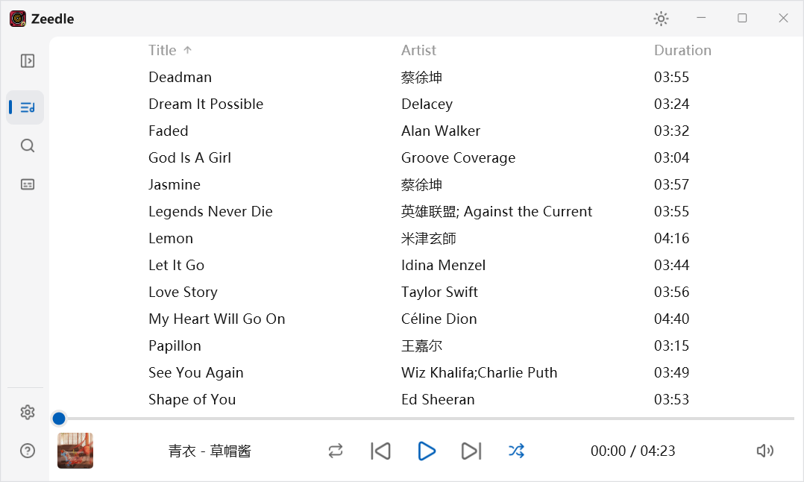
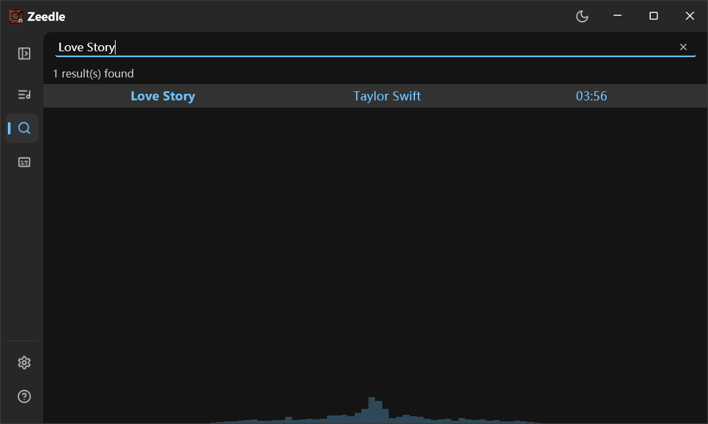
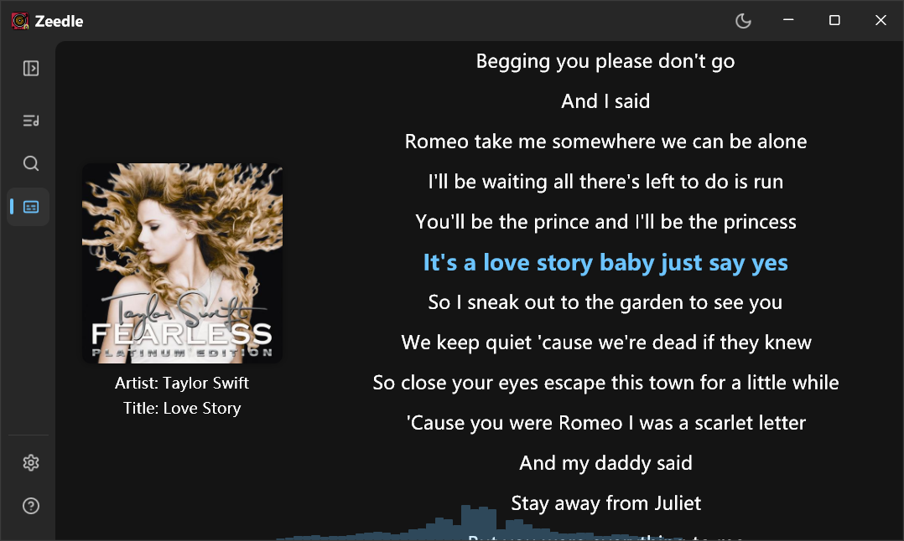
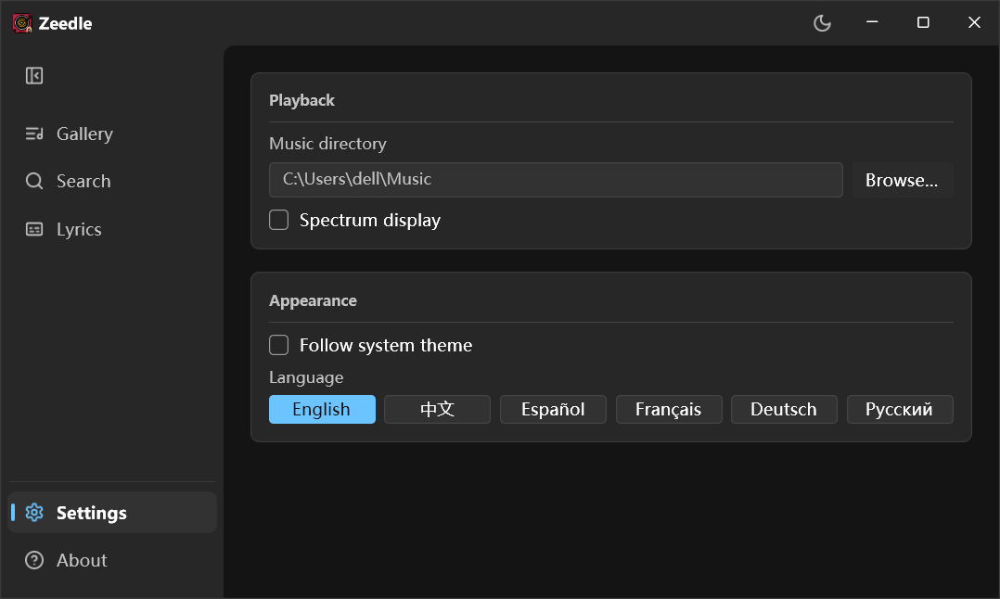
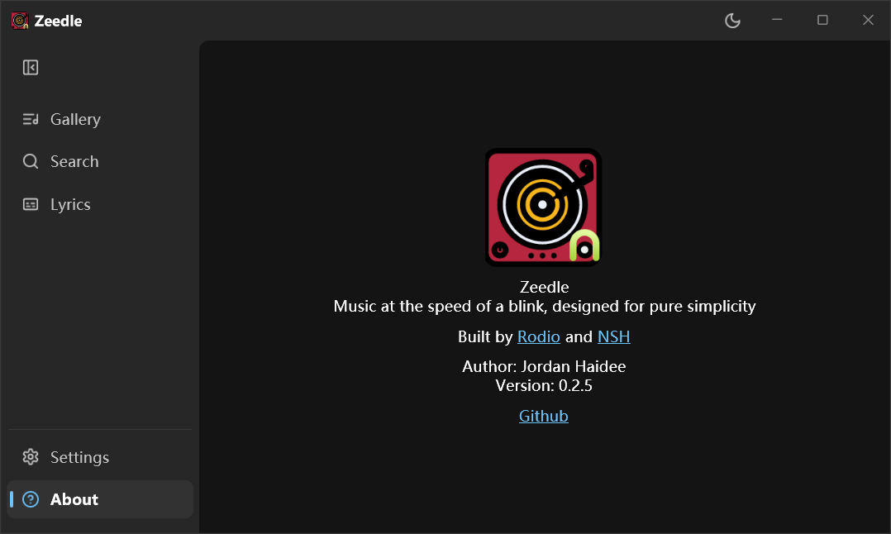
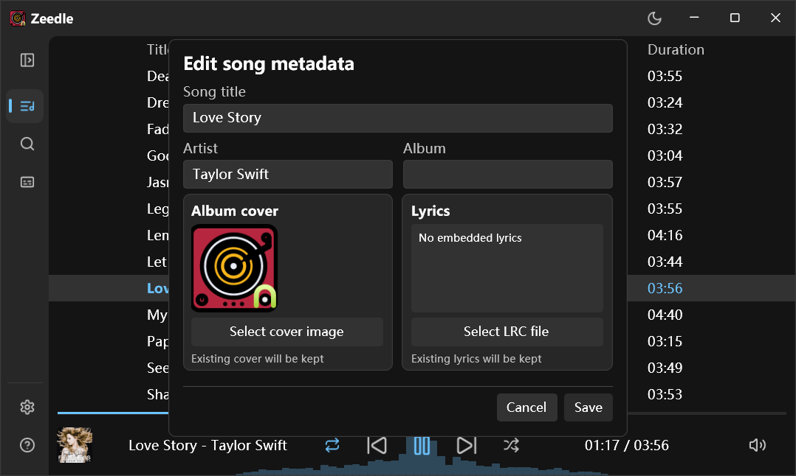

<p align="center">
  
</p>

<h1 align="center">Zeedle</h1>

<p align="center">
  <strong>A Native Shell (NSH) port of the <a href="https://github.com/Jordan-Haidee/zeedle">original Zeedle music player</a>.</strong><br>
  Music at the speed of a blink, designed for pure simplicity.
</p>

<p align="center">
  Built with <a href="https://nsh.dev">Native Shell</a>, Rust and Rodio
</p>

<p align="center"><a href="README.zh-CN.md">简体中文</a></p>

---

Zeedle is a lightweight desktop music player focused on your local library. This project brings the original Zeedle experience to [Native Shell](https://nsh.dev), with a TSX interface and a Rust audio and metadata backend.

## Features

- Browse and search local MP3, FLAC, WAV and OGG files.
- Follow embedded lyrics or adjacent LRC files, and seek by clicking a lyric line.
- View a live audio spectrum while music plays.
- Edit song metadata, album art and lyrics from the library.
- Choose playback order, repeat or shuffle, and use keyboard shortcuts for playback and navigation. Order follows the sorted library and wraps at either end; Repeat keeps the current track on Next; Shuffle avoids immediately picking the current track and lets Previous/Next retrace shuffle history.
- Close the window to keep Zeedle running in the system tray; show it again, rescan or exit from the tray menu.
- Switch between English, Chinese, Spanish, French, German and Russian, and follow the system theme.

## Development setup

Zeedle uses NSH 0.6.1 and Rust for its native audio backend. Bun runs the TypeScript formatter, linter and helper scripts. Install the tools below for your platform, then clone this repository.

### Windows

Use Windows 10 version 1809 or later. Install:

1. [Git for Windows](https://git-scm.com/download/win).
2. [Rust through rustup](https://www.rust-lang.org/tools/install). In the installer, choose the MSVC toolchain and install the Visual Studio C++ Build Tools with the Windows SDK when prompted. Then open PowerShell and select stable Rust:

   ```powershell
   rustup toolchain install stable
   rustup default stable
   ```

3. The [NSH CLI](https://nsh.dev/docs/installation/), pinned to the version used by this repository's CI:

   ```powershell
   $env:NSH_VERSION = 'v0.6.1'
   irm https://nsh.dev/install.ps1 | iex
   ```

   Open a new terminal after installation so the updated `PATH` is picked up. Install LLVM for `libclang` as described in NSH's [Windows prerequisites](https://nsh.dev/docs/installation/); if LLVM is outside `C:\Program Files\LLVM`, set `LIBCLANG_PATH` to its `bin` directory.
4. [Bun](https://bun.com/docs/installation):

   ```powershell
   irm https://bun.sh/install.ps1 | iex
   ```

### macOS and Linux

Install Git, stable Rust via [rustup](https://www.rust-lang.org/tools/install), and [Bun](https://bun.com/docs/installation). Install the repository's NSH version with the official installer:

```sh
export NSH_VERSION=v0.6.1
curl -fsSL https://nsh.dev/install.sh | sh
```

For platform requirements, see the [NSH installation guide](https://nsh.dev/docs/installation/). macOS development requires Xcode Command Line Tools. On Ubuntu 24.04, this project's Linux build needs GTK 4, WebKitGTK 6, GStreamer and the development packages listed in [the CI workflow](.github/workflows/cross-platform.yml).

### Clone and configure

From PowerShell, or the terminal for your platform:

```sh
git clone https://github.com/Jordan-Haidee/zeedle-nsh.git
cd zeedle-nsh
bun install --frozen-lockfile
git config core.hooksPath .githooks
```

The Git hook checks staged TS/TSX formatting and lint, then runs `nsh check` before each commit. Configure the hook once for each clone. `bun install` installs the project's local Oxfmt and Oxlint tools; Node.js is not required for them.

Check the installed tools and source:

```sh
nsh --version # expected: 0.6.1
rustc --version
bun --version
bun run fmt:check
bun run lint
nsh check -v
```

## Build and run

After setup, run the app in its native desktop window:

```sh
nsh run
```

The app directory starts the TSX interface in `App.tsx`. On Windows, use `nsh run --window-size 900x510` to set the initial window size. To run the UI tests, use `nsh test App.test.tsx`; playback tests need the local music fixtures listed below.

For an offscreen GUI screenshot on Windows, run the app entry through NSH's test host:

```powershell
@'
await app.waitFor("id:screen-0");
await app.screenshot("target/dev-check.png");
'@ | nsh test App.tsx --target windows
```

This captures the app through the test host and saves the image under the ignored `target/` directory.

To build a Windows setup installer, install [Inno Setup 6](https://jrsoftware.org/isinfo.php) and run `nsh package App.tsx --target windows`. It is not needed for `nsh run`.

To run the Tailwind language-server check:

```sh
bun run scripts/check-tailwind-lsp.ts
```

Playback integration tests use songs from the default Music folder, including **一眼万年**, **万疆**, **Deadman** and **Love Story**. Keep those tracks and their lyric metadata available when running the full suite; no copyrighted audio is included in this repository.

## Supported platforms and portable builds

Portable releases currently target Windows x64, Linux x64 and Apple Silicon macOS. The release workflow runs on each native platform, packages the app, captures its library, settings and About pages, and publishes only when all three jobs pass.

Build locally with NSH 0.6.1 and Rust:

```sh
nsh package --target linux
nsh package --target macos
```

On Windows, NSH's package command reads Zeedle's window and icon settings from `nsh.json` and creates an installer when Inno Setup 6 is installed:

```powershell
nsh package App.tsx --target windows
```

Each GitHub Release includes one Windows installer, one Linux package and one macOS app bundle, named `Zeedle-<tag>-windows-x86_64-setup.exe`, `Zeedle-<tag>-linux-x86_64.tar.gz` and `Zeedle-<tag>-macos-aarch64.app.zip`. CI also uploads the unarchived `.app` bundle. Linux requires GTK 4.14 and WebKitGTK 6.0; macOS requires version 14 or newer. The macOS package is an ad hoc signed `.app` bundle.

Push a tag matching the version in `nsh.json` (for example, `v0.2.5`) to build all three platform packages and publish a GitHub Release. The Actions workflow can also be started manually to validate packaging and screenshots without publishing.

For Windows rendering and startup checks:

```sh
nsh test tests/windows-visual.test.tsx --target windows
nsh test tests/platform-render.test.tsx --target windows
nsh test tests/platform-render.test.tsx --target linux
nsh test tests/platform-render.test.tsx --target macos
powershell -File scripts/check-windows-startup.ps1
```

The platform render test captures the library, settings and About screens from each native desktop host. CI runs the Linux test in Xvfb and uploads the screenshots for review.

## Project structure

- `App.tsx` — TSX interface and the default entry for `nsh run`.
- `src/lib.rs` and `src/spectrum.rs` — audio playback, metadata, browser links and spectrum analysis.
- `ui/icons/` — Lucide SVG interface icons.
- `theme.json` — light and dark theme tokens.

The original Zeedle project is maintained at [Jordan-Haidee/zeedle](https://github.com/Jordan-Haidee/zeedle). This repository is its NSH port; it is not the original Slint application.

## Screenshots

The following full-window captures show the Windows app in English with the dark theme enabled. The library capture shows Shuffle selected. Search, lyrics and metadata editing are shown with “Love Story” by Taylor Swift.

### Music library



### Search



### Synchronized lyrics



### Settings



### About



### Edit song metadata


