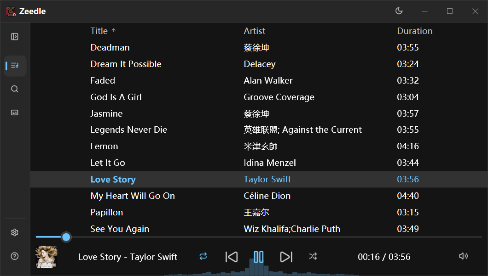
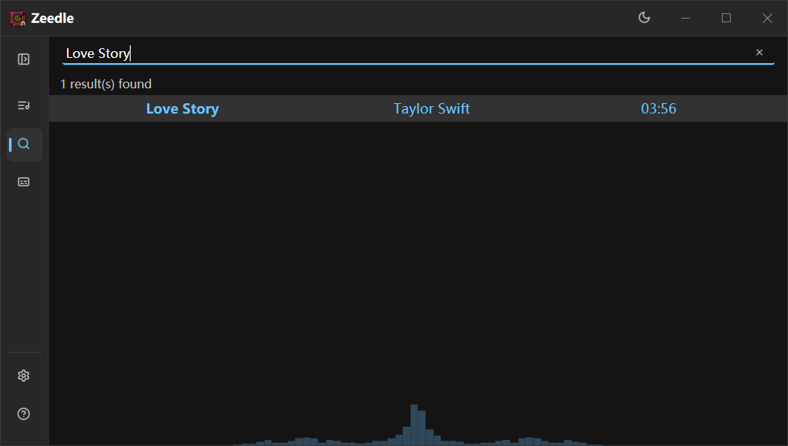
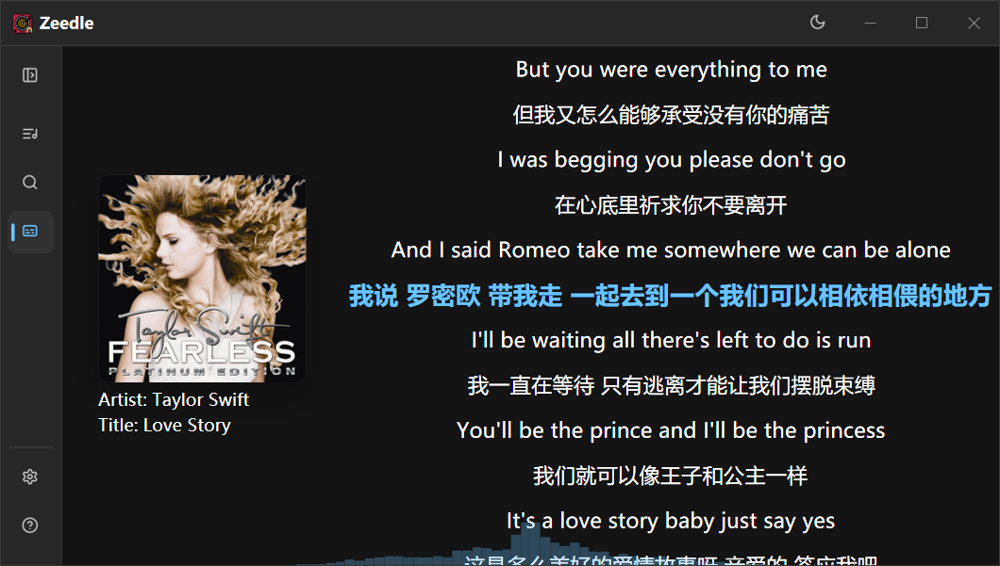
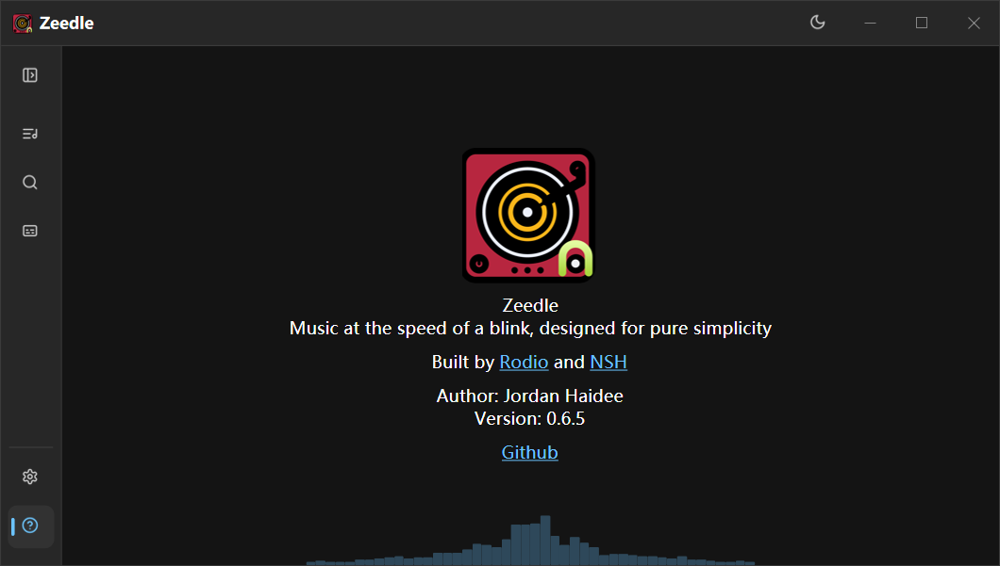
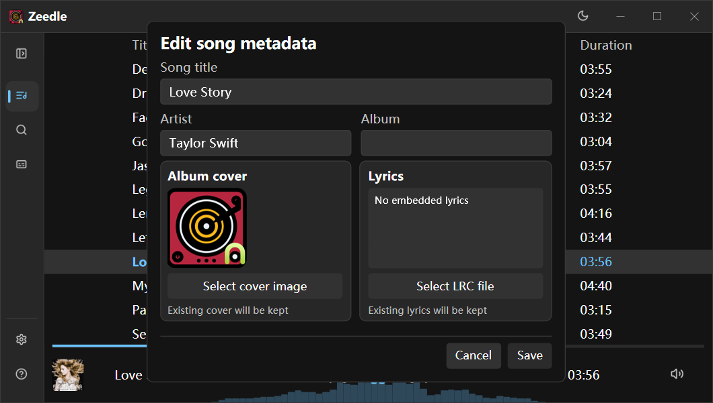

<p align="center">
  
</p>

<h1 align="center">Zeedle</h1>

<p align="center">
  <strong>A Native Shell (NSH) port of the <a href="https://github.com/Jordan-Haidee/zeedle">original Zeedle music player</a>.</strong><br>
  Music at the speed of a blink, designed for pure simplicity.
</p>

<p align="center">
  Built with <a href="https://nsh.dev">Native Shell</a>, Rust and Rodio
</p>

---

Zeedle is a lightweight desktop music player focused on your local library. This project brings the original Zeedle experience to [Native Shell](https://nsh.dev), with Rust and TSX interfaces sharing one Rust audio and metadata backend.

## Features

- Browse and search local MP3, FLAC, WAV and OGG files.
- Follow synchronized lyrics and seek by clicking a lyric line.
- View a live audio spectrum while music plays.
- Edit song metadata, album art and lyrics from the library.
- Choose playback order, repeat or shuffle; use keyboard shortcuts for playback and navigation.
- Switch between English, Chinese, Spanish, French, German and Russian, and follow the system theme.

## Build and run

Install the [NSH CLI](https://nsh.dev/docs/) and a Rust toolchain, then run:

```sh
nsh run
```

The app directory starts the TSX UI in `App.tsx` by default. On Windows, use `nsh run --window-size 900x510` to set the initial window size.

To temporarily run the Rust UI, use `pwsh -File scripts/run-rust-ui.ps1`. The script uses the Slint window size, restores `nsh.json` when NSH exits, and accepts NSH options such as `--window-size 1000x600`.

To check the app and run its tests:

```sh
nsh check -v
nsh test App.test.tsx
```

Playback integration tests use songs from the default Music folder, including **一眼万年**, **万疆**, **Deadman** and **Love Story**. Keep those tracks and their lyric metadata available when running the full suite; no copyrighted audio is included in this repository.

## Supported platforms and portable builds

Portable releases currently target Windows x64, Linux x64 and Apple Silicon macOS. The release workflow runs on each native platform, packages the app, captures its library, settings and About pages, and publishes only when all three jobs pass.

Build locally with NSH 0.3.0 and Rust:

```sh
nsh package --target linux
nsh package --target macos
```

On Windows, use the packaging script to include Zeedle's centered startup launcher and icon:

```powershell
powershell -File scripts/package-windows.ps1
```

The portable files attached to each GitHub Release are named `Zeedle-<tag>-windows-x86_64.zip`, `Zeedle-<tag>-linux-x86_64.tar.gz` and `Zeedle-<tag>-macos-aarch64.zip`; `<tag>` may be `0.1.1` or `v0.1.1`. Linux requires GTK 4.14 and WebKitGTK 6.0; macOS requires version 14 or newer. The macOS archive contains an ad hoc signed `.app` bundle. Windows and Linux packages are directories archived in their platform's standard format.

Push a tag matching the version in `nsh.json` (for example, `0.1.1`) to build all three archives and publish a GitHub Release. The Actions workflow can also be started manually to validate packaging and screenshots without publishing.

For Windows rendering and startup checks:

```sh
nsh test tests/windows-visual.test.tsx --target windows
nsh test tests/platform-render.test.tsx --target windows
nsh test tests/platform-render.test.tsx --target linux
nsh test tests/platform-render.test.tsx --target macos
powershell -File scripts/check-windows-startup.ps1
```

The platform render test captures the library, settings and About screens from each native desktop host. CI runs the Linux test in Xvfb and uploads all nine screenshots for review.

## Project structure

- `src/ui/` — Rust screens, navigation and player controls.
- `App.tsx` — TSX interface and the default entry for `nsh run`.
- `src/lib.rs` and `src/spectrum.rs` — audio playback, metadata, browser links and spectrum analysis.
- `assets/icons/` — Lucide SVG interface icons.
- `theme.json` — light and dark theme tokens.

The original Zeedle project is maintained at [Jordan-Haidee/zeedle](https://github.com/Jordan-Haidee/zeedle). This repository is its NSH port; it is not the original Slint application.

## Screenshots

The following full-window captures show the Windows app in English. Search, lyrics and metadata editing are shown with “Love Story” by Taylor Swift.

### Music library



### Search



### Synchronized lyrics



### Settings


### About



### Edit song metadata


