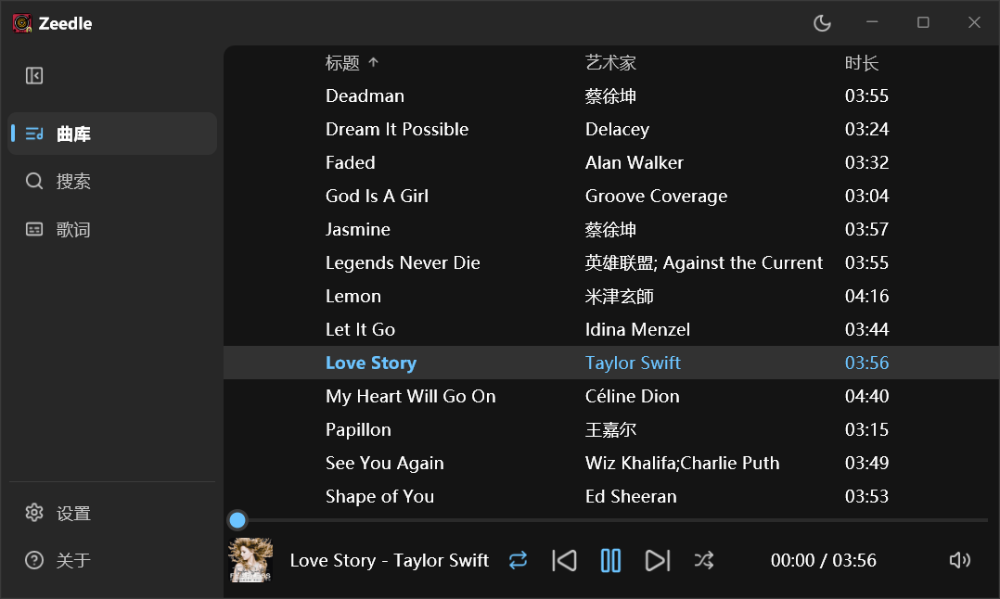
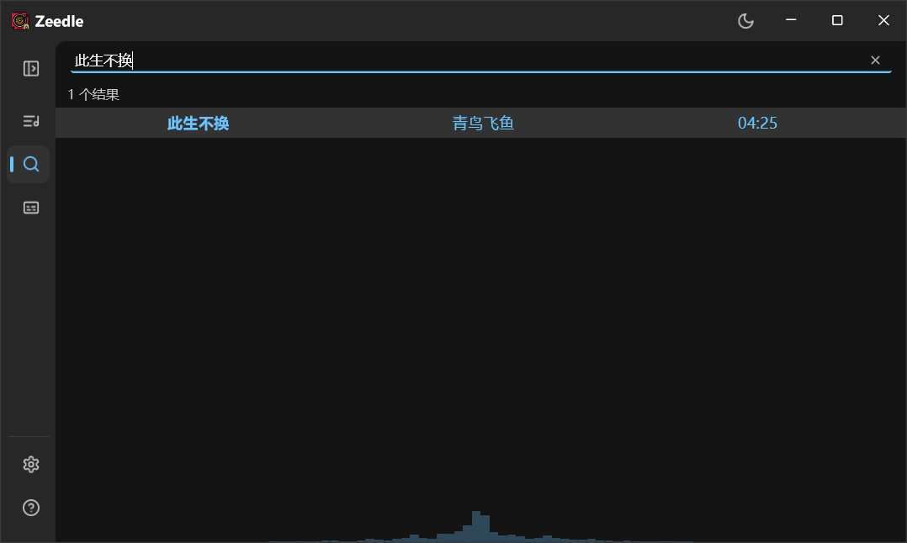
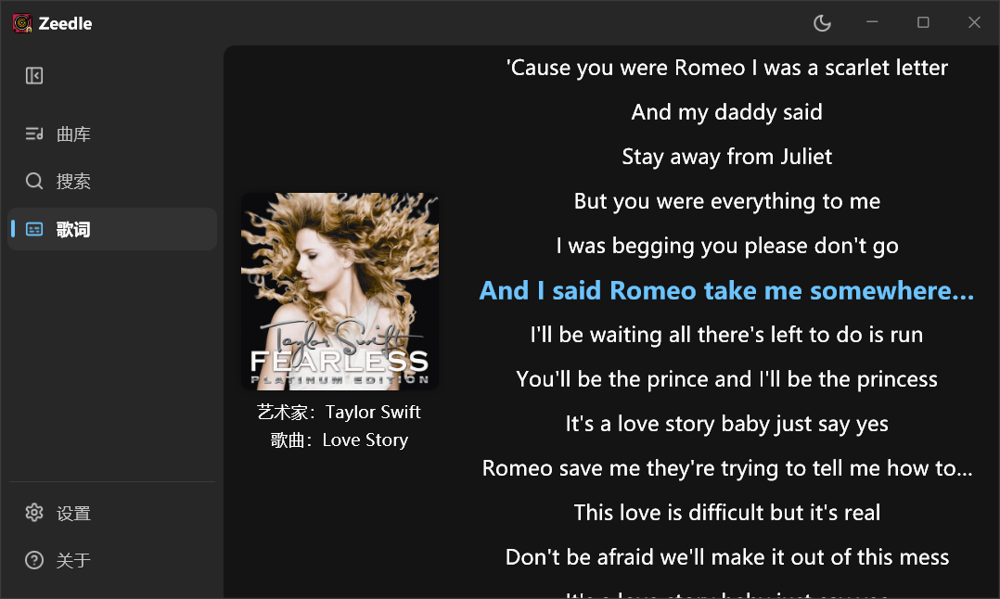
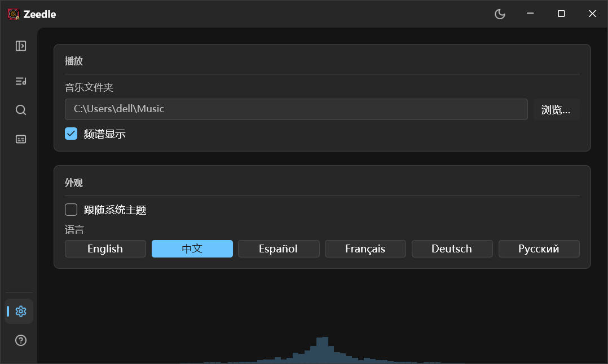
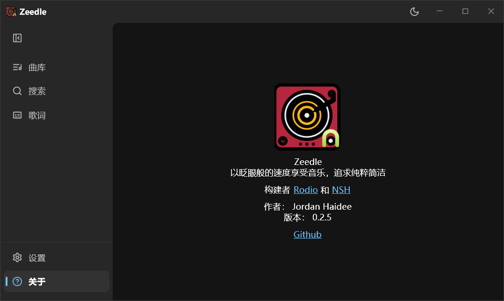
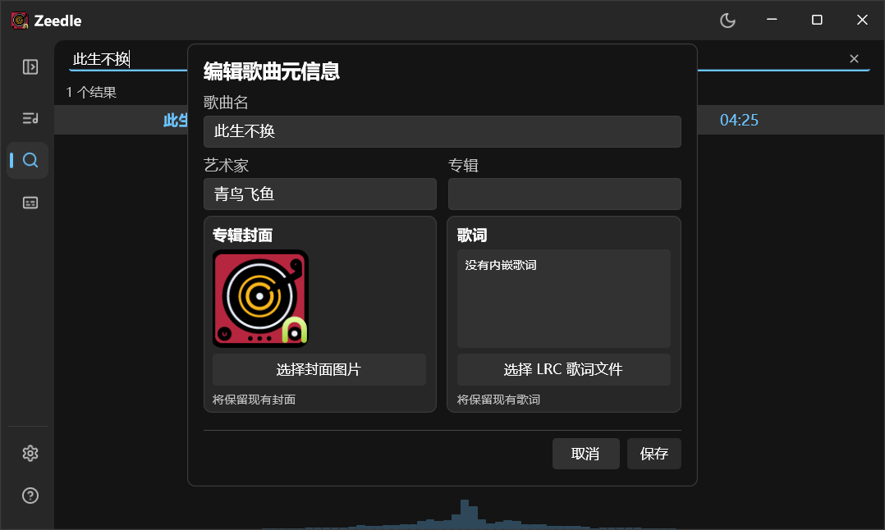

<p align="center">
  
</p>

<h1 align="center">Zeedle</h1>

<p align="center">
  <strong>使用 <a href="https://nsh.dev">Native Shell（NSH）</a>移植的本地音乐播放器。</strong><br>
  音乐即刻播放，设计简洁纯粹。
</p>

<p align="center">
  使用 <a href="https://nsh.dev">Native Shell</a>、Rust 和 Rodio 构建
</p>

<p align="center"><a href="README.md">English</a></p>

---

Zeedle 是一款轻量级桌面音乐播放器，专注于本地音乐库。本项目使用 TSX 界面和 Rust 音频、元数据后端，将 [原版 Zeedle](https://github.com/Jordan-Haidee/zeedle) 移植到 [Native Shell](https://nsh.dev)。

## 功能

- 浏览和搜索本地 MP3、FLAC、WAV 与 OGG 文件。
- 显示内嵌歌词或同目录的 LRC 歌词，并可点击歌词行跳转播放位置。
- 播放音乐时查看实时频谱。
- 在曲库中编辑歌曲信息、专辑封面和歌词。
- 选择顺序、单曲循环或随机播放，并使用键盘快捷键控制播放和切歌。顺序播放会按当前曲库排序循环；单曲循环模式下按“下一首”会重播当前歌曲；随机播放会避免连续选中同一首，并可通过上一首/下一首沿随机播放历史前后切换。
- 关闭窗口后让 Zeedle 继续在系统托盘运行；可以从托盘重新显示窗口、重新扫描曲库或退出程序。
- 支持英语、中文、西班牙语、法语、德语和俄语，并可跟随系统主题。

## 开发环境

Zeedle 使用 NSH 0.6.1 和 Rust 构建原生音频后端。Bun 用于运行 TypeScript 格式化、静态检查和辅助脚本。请为你的平台安装以下工具，然后克隆仓库。

### Windows

使用 Windows 10 版本 1809 或更新版本，并安装：

1. [Git for Windows](https://git-scm.com/download/win)。
2. [通过 rustup 安装 Rust](https://www.rust-lang.org/tools/install)。安装时选择 MSVC 工具链，并按提示安装 Visual Studio C++ Build Tools 和 Windows SDK。然后在 PowerShell 中选择 stable 工具链：

   ```powershell
   rustup toolchain install stable
   rustup default stable
   ```

3. [NSH CLI](https://nsh.dev/docs/installation/)，使用本仓库 CI 固定的版本：

   ```powershell
   $env:NSH_VERSION = 'v0.6.1'
   irm https://nsh.dev/install.ps1 | iex
   ```

   重新打开终端以载入更新后的 `PATH`。按照 NSH 的 [Windows 前置条件](https://nsh.dev/docs/installation/)安装 LLVM；如果 LLVM 不在 `C:\Program Files\LLVM`，请将 `LIBCLANG_PATH` 设置为其 `bin` 目录。
4. [Bun](https://bun.com/docs/installation)：

   ```powershell
   irm https://bun.sh/install.ps1 | iex
   ```

### macOS 和 Linux

安装 Git、通过 [rustup](https://www.rust-lang.org/tools/install) 安装 stable Rust，以及 [Bun](https://bun.com/docs/installation)。然后通过官方安装脚本安装本仓库所用的 NSH 版本：

```sh
export NSH_VERSION=v0.6.1
curl -fsSL https://nsh.dev/install.sh | sh
```

平台依赖请参阅 [NSH 安装指南](https://nsh.dev/docs/installation/)。macOS 开发需要 Xcode Command Line Tools。在 Ubuntu 24.04 上构建本项目还需要 GTK 4、WebKitGTK 6、GStreamer，以及 [CI workflow](.github/workflows/cross-platform.yml) 中列出的开发包。

### 克隆和配置

在 PowerShell 或其他平台的终端中运行：

```sh
git clone https://github.com/Jordan-Haidee/zeedle-nsh.git
cd zeedle-nsh
bun install --frozen-lockfile
git config core.hooksPath .githooks
```

Git hook 会在每次提交前检查暂存的 TS/TSX 文件格式和静态检查，并运行 `nsh check`。每个克隆仓库只需配置一次。`bun install` 会安装项目使用的 Oxfmt 和 Oxlint；运行它们不需要 Node.js。

检查已安装的工具和源码：

```sh
nsh --version # 应为 0.6.1
rustc --version
bun --version
bun run fmt:check
bun run lint
nsh check -v
```

## 构建和运行

在原生桌面窗口中运行应用：

```sh
nsh run
```

应用目录以 `App.tsx` 作为 TSX 界面入口。在 Windows 上可使用 `nsh run --window-size 900x510` 设置初始窗口大小。运行 UI 测试请使用 `nsh test App.test.tsx`；播放集成测试需要下方列出的本地音乐样例。

在 Windows 上通过 NSH test host 离屏截取界面：

```powershell
@'
await app.waitFor("id:screen-0");
await app.screenshot("target/dev-check.png");
'@ | nsh test App.tsx --target windows
```

截图由 test host 捕获并保存到被忽略的 `target/` 目录。

构建 Windows 安装包时，请先安装 [Inno Setup 6](https://jrsoftware.org/isinfo.php)，再运行 `nsh package App.tsx --target windows`。运行 `nsh run` 不需要 Inno Setup。

运行 Tailwind language server 检查：

```sh
bun run scripts/check-tailwind-lsp.ts
```

播放集成测试会使用默认 Music 目录中的歌曲，包括 **一眼万年**、**万疆**、**Deadman** 和 **Love Story**。运行完整测试套件时，请确保这些歌曲及其歌词元数据可用；仓库不包含受版权保护的音频。

## 支持的平台和便携构建

便携版目前支持 Windows x64、Linux x64 和 Apple Silicon macOS。Release workflow 会在对应原生平台上打包应用、截取曲库、设置和关于页面，并在三个平台任务全部通过后发布。

安装 NSH 0.6.1 和 Rust 后，可在本地构建：

```sh
nsh package --target linux
nsh package --target macos
```

在 Windows 上，NSH package 命令从 `nsh.json` 读取窗口和图标设置；安装 Inno Setup 6 后会生成安装包：

```powershell
nsh package App.tsx --target windows
```

每个 GitHub Release 包含一个 Windows 安装程序、一个 Linux 软件包和一个 macOS 应用压缩包，文件名分别为 `Zeedle-<tag>-windows-x86_64-setup.exe`、`Zeedle-<tag>-linux-x86_64.tar.gz` 和 `Zeedle-<tag>-macos-aarch64.app.zip`。CI 也会上传未压缩的 `.app` bundle。Linux 需要 GTK 4.14 和 WebKitGTK 6.0；macOS 需要 14 或更新版本。macOS 软件包使用 ad hoc 签名。

推送与 `nsh.json` 中版本号匹配的 tag（例如 `v0.2.6`），即可构建三个平台的软件包并发布 GitHub Release。也可以手动启动 Actions workflow 来验证打包和截图，而不发布版本。

Windows 渲染和启动检查：

```sh
nsh test tests/windows-visual.test.tsx --target windows
nsh test tests/platform-render.test.tsx --target windows
nsh test tests/platform-render.test.tsx --target linux
nsh test tests/platform-render.test.tsx --target macos
powershell -File scripts/check-windows-startup.ps1
```

平台渲染测试会从各原生桌面 host 截取曲库、设置和关于页面。CI 会在 Xvfb 中运行 Linux 测试并上传截图供检查。

## 项目结构

- `App.tsx` — TSX 界面和 `nsh run` 的默认入口。
- `src/lib.rs` 和 `src/spectrum.rs` — 音频播放、元数据、浏览器链接和频谱分析。
- `ui/icons/` — Lucide SVG 界面图标。
- `theme.json` — 亮色和暗色主题 token。

原版 Zeedle 项目由 [Jordan-Haidee/zeedle](https://github.com/Jordan-Haidee/zeedle) 维护。本仓库是它的 NSH 移植版，不是原始 Slint 应用。

## 界面截图

以下截图使用 Windows 暗色主题，开启频谱显示并收起侧栏。播放相关页面展示“此生不换”正在播放及其进度。

### 音乐曲库



### 搜索



### 同步歌词



### 设置



### 关于



### 编辑歌曲信息


